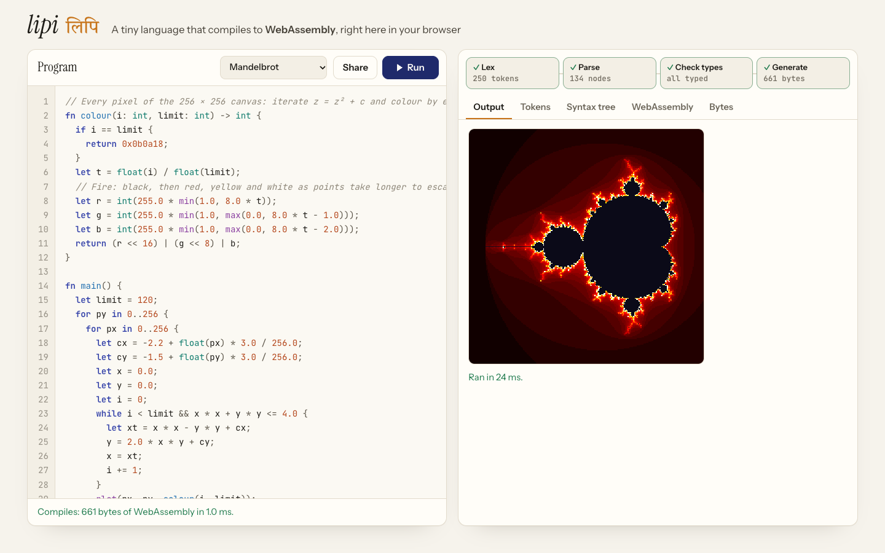
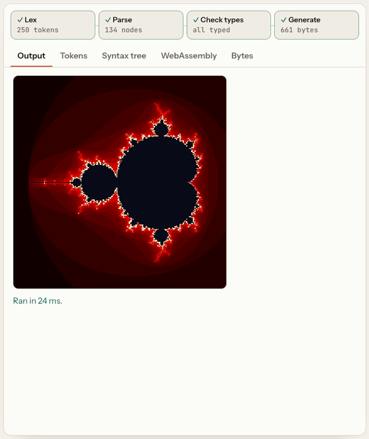

# lipi लिपि

[](https://samarthjaiswal.github.io/lipi/)
[](https://github.com/SAMARTHJAISWAL/lipi/actions/workflows/ci.yml)

*लिपि* (lipi) is Hindi for "script", as in a writing system.

**A small programming language, and its compiler, running in your browser.** You write a program; lipi turns it into real WebAssembly bytes and runs it. Every stage of the compiler is on screen: the tokens, the syntax tree with a type on every expression, the WebAssembly text, and the binary itself, byte by byte.

The compiler is written from scratch in TypeScript: no parser generator, no WebAssembly toolkit, no dependencies. It is tested by **differential fuzzing**: thousands of random programs are compiled to WebAssembly and also run through a separate interpreter, and the two must agree on every line of output and every runtime error.

**[Open the playground →](https://samarthjaiswal.github.io/lipi/)**



<p align="center"></p>

## The language

```
fn gcd(a: int, b: int) -> int {
  if b == 0 {
    return a;
  }
  return gcd(b, a % b);
}

fn main() {
  for i in 1..6 {
    print(gcd(i * 12, 18));
  }
}
```

- **Types:**
  - `int` (32-bit, wrapping on overflow), `float` (64-bit) and `bool`.
  - They never mix silently. `1 + 2.0` is an error that suggests `float(...)` or `int(...)`.
  - A `let` takes its type from its value, or from an annotation (`let x: float = 1.0;`).
- **Statements:**
  - `let`, and assignment with `=`, `+=`, `-=`, `*=`, `/=` and `%=`.
  - Branches and loops: `if`/`else if`/`else`, `while`, and `for i in a..b`, where `b` is not included and is evaluated once.
  - `break`, `continue` and `return`.
- **Expressions:**
  - arithmetic, and comparisons that produce bools;
  - `&&` and `||`, which short-circuit, and `!`;
  - bit operations on ints (`& | ^ << >>`);
  - hex literals such as `0xff8800`, and floats with exponents such as `1e-3`.
- **Functions:**
  - parameters and the result have types;
  - every path must return, which is checked;
  - recursion works;
  - blocks have their own scope, and inner blocks may shadow outer names.
- **Built in:**
  - `print` (int, float or bool);
  - `plot(x, y, rgb)` for a 256 × 256 canvas;
  - `sqrt`, `floor`, `abs`, `min`, `max`;
  - the conversions `float(n)` and `int(x)`. `int` rounds towards zero, clamps to the int range, and turns NaN into 0.

Errors say where and what to do. Some examples:
- "There is no function called "prnt". Did you mean print?"
- "area's r must be a float, not an int. Use float(...) to convert, or write the number with a decimal point (2.0)"
- "f must return an int on every path; this point can be reached without a return"

The examples cover FizzBuzz, Fibonacci both recursively and with a loop, primes, the longest Collatz chain under 10,000, an interference pattern, a deliberate type error, and the Mandelbrot set. The Mandelbrot compiles to 661 bytes and runs about 1.6 million loop iterations in around 25 ms.

## How the compiler works

```
source ─▶ lexer ─▶ tokens ─▶ parser ─▶ syntax tree ─▶ type checker ─▶ typed tree ─▶ code generator ─▶ .wasm bytes + text
                                                                                                         │
                                         page ◀── output and pixels ◀── Web Worker runs main() ◀──────────┘
```

- **Lexer** (`src/lang/lexer.ts`): characters into tokens, with comments and spaces dropped. It tells `0..10` (a range) apart from `0.5` (a float).
- **Parser** (`src/lang/parser.ts`): a recursive-descent parser, using precedence climbing for the ten levels of binary operators. It folds `-2147483648` into a single literal, so the smallest int can be written, while `2147483648` on its own is rejected as too big.
- **Type checker** (`src/lang/check.ts`):
  - **Types:** gives every expression a type and picks the right version of an overloaded built-in (`abs` on an int or a float).
  - **Scopes:** resolves every name to a local slot, keeping block scopes and shadowing apart.
  - **Return paths:** proves every path through a function returns, and rejects code after a `return`, `break` or `continue`.
- **Code generator** (`src/lang/codegen.ts`, `src/lang/wasm.ts`): writes the binary format by hand.
  - **Sections:** the type, import, function, export, code and `name` sections, using LEB128 integers and little-endian floats.
  - **Loops:** `while` becomes `block`/`loop`/`br_if`. A `for` loop gets an inner block so that `continue` still runs its increment.
  - **`&&` and `||`** become a typed `if`.
  - **Built-ins:** `abs`, `min` and `max` on ints use `select`. The rest map to single instructions (`f64.sqrt`, `i32.trunc_sat_f64_s`, …) or to imported functions (`print`, `plot`).
  - **Text and byte map:** the same pass writes the WebAssembly text format and records where each section and function body sits in the binary, which is what colours the hex view.
- **Runner** (`src/run/`): the module runs in a Web Worker. A program that never ends is stopped after 5 seconds, or by pressing Stop, and the page never freezes. Output and pixels come back in batches. Runtime errors are put into plain words: a division by zero, the one int overflow (`-2147483648 / -1`), or recursion that runs out of stack.

The playground compiles as you type and underlines errors in place. It shows how long each stage took, and its links hold the whole program, compressed into the URL fragment. A link is decompressed only up to 100,000 characters, so a crafted link can't flood the page.

## Testing

`npm test` runs 41 tests in about a second, including 1,500 random programs; `FUZZ_SEEDS=20000` runs 20,000 in about 7 seconds.

- **Differential fuzzing** (`tests/fuzz.ts`, `tests/differential.test.ts`).
  - **The generator** writes random, well-typed programs:
    - helper functions calling earlier helpers, plus recursive functions with bounded depth;
    - nested `if`, `while` and `for`, with `break`, `continue` and early `return`;
    - variables that shadow outer ones, and names that collide with built-ins or with the compiler's own scratch locals (`abs`, `tmp1`), and a user function called `print_int`;
    - every operator and built-in.
  - **The inputs** are chosen to provoke edge cases: `2147483647`, `-2147483648`, `0xffffffff`, `1e300`, `-0.0`, `4294967296.0`.
  - **The check:** each program is compiled to WebAssembly and run in Node, then run again through a tree-walking interpreter (`src/lang/interp.ts`) written independently from the code generator. The two must print exactly the same lines and stop with the same runtime error.
  - **What it found:** a real code-generation bug, before anyone else saw it. A nested `max(a, max(b, c))` overwrote the outer call's first argument, because both used the same scratch local. That is fixed and kept as a regression test.
- **Examples:** every example compiles to a module that `WebAssembly.validate` accepts, prints exactly the expected output, and matches the interpreter.
- **Errors:** 17 kinds of mistake, each checked for the stage, the message and the exact line and column.
- **The binary:** the byte map covers every byte exactly once and in order, and the WebAssembly text names every function and local, never twice (checked on 400 random programs as well).
- **Review fixes:** an independent review found no miscompile, but did find nine smaller problems, each now fixed and tested:
  - **The worst one:** `0 - 2147483648 / 2` slipped an out-of-range literal past the check, because the minus in front of it was taken as a negative sign. It is now rejected.
  - **WebAssembly text view:** `-0.0` displayed as `0`, and names could repeat (a function called `print_int`, a variable called `tmp1`).
  - **Large and odd programs:** absurdly deep nesting crashed the compiler instead of giving an error, and a 40,000-line function crashed the code generator.
  - **Share links:** a crafted link could expand to gigabytes, and a very large program couldn't be shared.
  - **Two misleading messages:** `0x_`, and returning a call that returns nothing.

`scripts/e2e.py` (Python Playwright) checks 41 things in a real browser:

- **Running:**
  - the opening program draws the Mandelbrot set;
  - each example prints its expected output;
  - a type error is underlined, its line is flagged, the failing stage is marked, and the program isn't run;
  - fixing the error clears it as you type, and Ctrl+Enter runs.
- **When things go wrong:**
  - division by zero and runaway recursion are explained in plain words;
  - Stop ends an endless loop at once, and the 5-second limit ends it anyway, while the page stays responsive.
- **The rest of the page:**
  - every tab shows its stage, arrow keys move between tabs, and clicking a pipeline stage opens its view;
  - a Share link reopens and reruns the same program, in a new tab or pasted into an open one;
  - the editor indents after `{` and outdents `}`, and the draft survives a reload;
  - on a phone, there is no sideways scrolling and every control is big enough to tap.

## Project layout

```
src/
  lang/             the compiler: no DOM, runs in Node too
    lexer.ts, parser.ts, ast.ts
    check.ts          types, scopes, return paths, built-ins
    codegen.ts        WebAssembly binary + text + byte map
    wasm.ts           LEB128, opcodes, sections
    interp.ts         the reference interpreter
    traps.ts          runtime errors, in every engine's wording
  run/              worker.ts runs a module; runner.ts starts and stops it
  ui/               editor (highlighting, gutter, indentation), views, sharing
  examples.ts
tests/            Vitest: examples, errors, binary map, differential fuzzing
scripts/          e2e.py and capture.py (Python Playwright)
```

The production bundle is about 47 KB of JavaScript (17 KB gzipped) plus a 1 KB worker. It uses the Instrument Serif, Instrument Sans, JetBrains Mono and Tiro Devanagari Hindi fonts, bundled through Fontsource. There are no runtime dependencies.

## Running locally

Requires Node 22.12 or later.

```sh
npm ci
npm run dev          # http://localhost:5173
npm test
FUZZ_SEEDS=20000 npx vitest run tests/differential.test.ts
npm run build:pages  # dist/, served from /lipi/ (what GitHub Pages gets)
```

End-to-end checks and screenshots use Python Playwright (`pip install playwright pillow && playwright install chromium`):

```sh
npm run build && npx vite preview --port 4173 &
python scripts/e2e.py http://localhost:4173/
python scripts/capture.py http://localhost:4173/
```

Pushing to `main` runs CI (typecheck, tests, both builds) and deploys to GitHub Pages.

## References

- [WebAssembly Core Specification](https://webassembly.github.io/spec/core/): section 5, Binary Format, and the instruction reference.
- Robert Nystrom, [Crafting Interpreters](https://craftinginterpreters.com/): the shape of the lexer, the parser and the tree-walking interpreter.
- William McKeeman, Differential Testing for Software. Digital Technical Journal, 1998.

## Licence

[MIT](LICENSE) © 2026 Samarth Jaiswal
